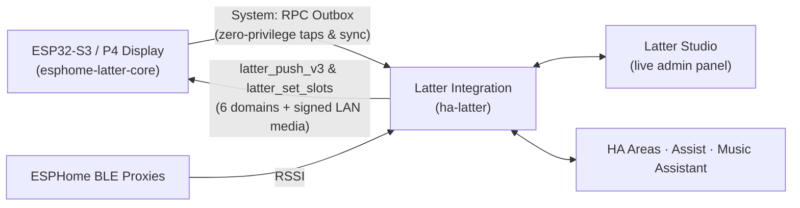

# Latter

Turnkey Home Assistant integration and **Latter Studio** control plane for ESPHome touch displays, wearables, couch remotes, and Bluetooth Area presence.

Most ESPHome display projects hardcode entity IDs into YAML—a renamed light, a new speaker, or carrying a handheld into another Area means editing YAML and reflashing. Latter keeps that mapping in Home Assistant instead: every device knows which Area it is in, and Latter pushes the right controls, media, weather, agenda, and images to it live at runtime.

<!-- MEDIA: docs/media/hero.jpg — all five devices on a desk, each showing a different app (Home, Music, Area Control, Time, Sky & Weather). -->

| Repository | Runs on | Responsibility |
| :--- | :--- | :--- |
| **ha-latter** *(this repo)* | Home Assistant | Integration and **Latter Studio**: live entity mapping, BLE Area presence & sensor fusion, signed ESP32 media proxy, and 19 `latter.*` services. |
| **[esphome-latter-core](https://github.com/slampton/esphome-latter-core)** | ESP32-S3 / ESP32-P4 | Compiled C++20 firmware for five Waveshare touch displays, [Web Installer](https://slampton.github.io/esphome-latter-core/), and the Latter Core SDK. |

You need both repos for the touch displays. If you only want BLE Area presence and occupancy fusion from the Bluetooth proxies, phones, watches, and beacons you already own, `ha-latter` works standalone.

---

## Get Started in Minutes

**1. Pick a supported board.** All five run the full Latter OS without modification:

| Device | Waveshare Hardware | Display | Best For |
| :--- | :--- | :--- | :--- |
| **Pocket Assistant** | [Waveshare ESP32-S3-Touch-AMOLED-1.75C][ws-175c] | 1.75" round AMOLED, 466×466 | Carrying room to room; voice and music |
| **Mobile Assistant** | [Waveshare ESP32-S3-Touch-AMOLED-2.16][ws-216] | 2.16" square AMOLED, 480×480 | Handheld album art, sliders, and browsing |
| **Wrist Assist** | [Waveshare ESP32-S3-Touch-AMOLED-2.06][ws-206] | 2.06" watch AMOLED, 410×502 | Wearable timers, alarms, Assist, and per-person presence |
| **Remote Assistant** | [Waveshare ESP32-P4-WIFI6-Touch-LCD-3.5][ws-p4-35] | 3.5" IPS, 320×480 | Fast P4 couch remote for TVs and media |
| **Desk Assistant** | [Waveshare ESP32-P4-86-Panel-ETH-2RO][ws-p4-desk] | 4.0" IPS, 720×720 | Always-on desk or wall panel |

Hardware links above are Waveshare affiliate links—buying through them supports Latter at no extra cost to you. (On the Desk Assistant page, select the validated `ESP32-P4-86-Panel-ETH-2RO` option.)

**2. Flash it in Chrome or Edge** over USB-C with the **[Latter Web Installer](https://slampton.github.io/esphome-latter-core/)**, configure Wi-Fi over the same USB cable, and adopt the discovered ESPHome device in Home Assistant (leave *"Allow the device to perform Home Assistant actions"* **off**). → [Flashing guide](https://github.com/slampton/esphome-latter-core/blob/main/docs/flashing.md)

**3. Install Latter via HACS:** open **HACS → ⋮ → Custom repositories**, add `https://github.com/slampton/ha-latter` as **Integration**, download **Latter**, and restart Home Assistant.

**4. Accept discovery & open Latter Studio:** click **Add** on **Discovered: Latter** under **Settings → Devices & Services**, then open **Latter** in the sidebar to map your shared entities, speakers, and themes live. → [Full walkthrough](docs/getting-started.md)

---

## What It Does

### Devices Know Which Area They're In
Latter reads RSSI from your existing Bluetooth proxies to track Latter displays, phones and watches (via Home Assistant's [Private BLE Device](https://www.home-assistant.io/integrations/private_ble_device/) integration), and iBeacons.
- **Voice Follows Me:** when a roaming handheld or watch moves to a new Area, Latter updates its Home Assistant Area so *"Turn off the lights"* to Assist targets where you're standing. Fixed panels sync their **Assigned Area** two-way with Home Assistant.
- **Cross-floor & sensor fusion:** per-Area occupancy binary sensors fuse BLE with mmWave, PIR, and door sensors, applying a 6 dB cross-floor penalty so upstairs devices don't flap into downstairs Areas.

<!-- MEDIA: docs/media/presence-walk.gif — walking between Areas with Wrist Assist while Latter Studio switches the active Area. -->

→ [How presence works, and how it compares to Bermuda](docs/presence.md)

### Music Assistant on a Small Screen
- **Paginated browsing:** favorites, playlists, artists, albums, podcasts, radio, and audiobooks sized to each screen's geometry.
- **Seamless speaker moves & grouping:** transfer playback queues across speakers (holding metadata and album art steady across spin-up and healing cold/idle queues automatically) or join/unjoin speaker groups.
- **Lyrics, bios & universal transport:** pulls lyrics from Music Assistant or [LRCLIB](https://lrclib.net) and bios from Wikipedia; transport, seek, and AV-receiver volume overrides work with any `media_player`.

### Dynamic Area Control, 6-Tab Home Hub & Time
- **Area Control:** scenes, lights (brightness, HSV color wheel, 2700–6500 K temperature), blinds/curtains, fans, switches, climate, and media—ordered and filtered automatically to entities present in the active Area.
- **6-Tab Home Hub & PIN Policies:** whole-home **Alarm**, **Cameras** (up to 10 live snapshots), **Intercom**, **Thermostat**, **Entry & Garage**, and **Vacuum**. Home Assistant `alarm_control_panel` codes pass straight through for arming/disarming as required by the panel (`alarm_caps`), while per-device **Perimeter Security Policies** (`Auto`, `Allow`, `Require PIN`, or `Block`) guard locks, garage covers, and code-less alarms.
- **Time, World Clocks & 2-Way Alarms:** custom-labeled World Clocks (`UTC-12:00..UTC+14:00`), optional UTC card, local countdown timers, stopwatch, and 3 recurring NVS alarms synced two-way between the screen and Studio.

### Auto-Detected Doorbell Popups
Latter detects your doorbell's ring entity automatically, wakes displays for 20 seconds with a live camera snapshot, and lets you **listen** (FFmpeg noise-reduced audio), **reply by push-to-talk** or quick replies (spoken via TTS on the doorbell's speaker; [experimental](#project-status)), or **unlock** the door.

<!-- MEDIA: docs/media/doorbell.gif — doorbell press waking Desk Assistant with a live camera popup. -->

### Latter Studio
An admin-only sidebar control plane where every change pushes live without reflashing:
- **System scope:** shared whole-home entities, cameras & doorbell audio filter, 6 built-in `720p` wallpapers + 15 MB photo uploads, 24-swatch custom color library, TV/AV remotes & remote groups, operational Device Groups, live WebSocket BLE calibration, doorbell speaker testing, HMAC key rotation, and JSON backup/restore.
- **Per-device scope:** **Overview** status tiles & quick actions, **Display** (weather sky, screensavers, brightness, themes, wallpapers), **Interface** (single-app kiosk mode, start screen, dock apps, Area/Home category pills, World Clocks & 2-way Alarms), **Audio**, **Power**, **Presence**, and **Tools**.

<!-- MEDIA: docs/media/studio-overview.png — Latter Studio, System → Overview. -->

→ [Latter Studio guide](docs/studio.md)

---

## Under the Hood

- **Zero-Privilege Bound RPC & 6-Domain Protocol v3 Push.** Devices bind strictly by `esphome_device_id` and hardware MAC (`via_device_id`). Outbound device taps emit compact chunked frames on `System: RPC Outbox` (`identity.py`) and inbound state pushes directly over `esphome.<node>_latter_push_v3` across 6 content-hashed domains (`area_context`, `active_media`, `remote_config`, `weather_forecast`, `calendar_agenda`, `device_prefs`) plus `latter_set_slots`—requiring neither `allow_service_calls` nor `device_slug` YAML substitutions, and keeping `~8 KB` of signed URLs off Home Assistant's `state_changed` bus and SQLite recorder.
- **3-Tier Sleep-Safe Entity Architecture & `O(1)` `AreaStateIndex`.** All 50 device preferences persist in subentries (`studio/settings.py`) and reconcile offline NVS edits on `device_hello`, so Studio and Device Groups work even while battery handhelds hibernate. Home Assistant gets a clean Tier 2 automation surface (`Power Profile`, `Wake Word Mode`, `Alert Volume`, `Find My Device`, `Activate Screensaver`, `Timer Active`, `Timer Remaining`, `Alarm Ringing`) backed by 1 Hz local timer ticks and an incremental `O(1)` `AreaStateIndex` (`hub.py`—never calling `hass.states.async_all()`).
- **ESP32-Native Signed Media Proxy.** ESP-IDF's JPEG decoder rejects progressive JPEGs and can't resolve `.local` mDNS hostnames. Latter re-encodes artwork, `720p` wallpapers, camera snapshots (with predictive live-feed prefetching), and OpenStreetMap event pins as baseline 4:2:0 JPEG on executor threads—applying circular masks on round panels—and serves them over Home Assistant's numeric LAN IPv4 with constant-time, parameter-scoped HMAC signatures (`http.py`).

---

## Already Running ESPHome or Building Your Own?

- **Use existing Bluetooth proxies & phones for presence:** track phones, watches, and iBeacons without flashing Latter display firmware. → [Existing ESPHome devices](docs/existing-esphome.md) · [Presence & Bermuda comparison](docs/presence.md#coming-from-bermuda)
- **Automate or build custom hardware:** everything the flagship displays use is open and documented:

| Reference | Covers |
| :--- | :--- |
| **[Services](docs/reference/services.md)** | All 19 `latter.*` services, parameters, security PIN rules, and special targets (`all`, `occupied_areas`, `person.<id>`) |
| **[Entities](docs/reference/entities.md)** | The 3-tier entity architecture across all 6 Home Assistant platforms, occupancy attributes, and `latter_event` payloads |
| **[HTTP API](docs/reference/http-api.md)** | Signed baseline-JPEG & FLAC endpoints, Bearer wallpaper upload, and Studio WebSocket architecture |
| **[Device protocol](https://github.com/slampton/esphome-latter-core/blob/main/docs/device-protocol.md)** | Discovery, Manifest v2, 6-domain Protocol v3 push, and `System: RPC Outbox` framing |
| **[Building a GUI](https://github.com/slampton/esphome-latter-core/blob/main/docs/building-a-gui.md)** | Writing a custom touch or rotary UI on top of `esphome-latter-core` |

---

## Requirements & Project Status

| Requirement | Version | Notes |
| :--- | :--- | :--- |
| **Home Assistant** | `2026.10` or newer | |
| **ESPHome** | `2026.11.0b5` or newer | Only needed when compiling firmware in ESPHome Device Builder |
| **Music Assistant** | `2.10.8` or newer *(optional)* | Needed for library browsing, queue transfer, and default intercom speakers |
| **Bluetooth proxies** | 1 per Area *(optional)* | ESPHome active proxies verified; assign each proxy to its Home Assistant Area |
| **`ffmpeg`** | Optional (bundled in HA OS) | Used for noise-reduced doorbell camera audio streaming |

**Local-first network footprint:** everything runs locally on your LAN except four optional lookups—OpenStreetMap tiles + Nominatim geocoding for calendar event maps, and LRCLIB lyrics + Wikipedia bios when Music Assistant lacks text metadata.

**Version `3.0.0` Status:**
- **Stable:** device discovery, Latter Studio, 6-domain Protocol v3 sync, Area control, Home Hub, Time/Alarms, Music Assistant browsing & transfer, BLE Area presence & sensor fusion, doorbell camera popups, and JSON backup/restore.
- **Experimental / Current Limits:** doorbell listen & push-to-talk TTS reply (no live device-to-door audio or on-device echo cancellation yet); BLE calibration uses one offset per Area rather than per-scanner trilateration.
- **CI Gate:** every push to `dev` runs `hassfest`, HACS validation, `ruff`, `tools/verify_ha.py`, TypeScript + Lit Studio bundle parity (`npm --prefix frontend_src run check`), and the `pytest` suite (`>= 75%` coverage across the **31-module** backend: 27 root `.py` modules + 4 `studio/` `.py` modules) before fast-forwarding `main`.

Bugs and feature requests: [GitHub Issues](https://github.com/slampton/ha-latter/issues).

---

## Documentation & Removal

| Guide | Covers |
| :--- | :--- |
| **[Getting started](docs/getting-started.md)** | Unboxing to working in ~20 minutes |
| **[Latter Studio](docs/studio.md)** | Every System and Device view in the Studio sidebar panel |
| **[Presence](docs/presence.md)** | BLE Area tracking, live calibration, sensor fusion, and migrating from Bermuda |
| **[Existing ESPHome devices](docs/existing-esphome.md)** | Using your Bluetooth proxies, beacons, and phones |
| **[Automations](docs/automations.md)** | Copy-paste YAML recipes for notifications, intercom, presence, and alarms |
| **[Troubleshooting](docs/troubleshooting.md)** | Common setup, image, presence, music, and update fixes |
| **[Reference](docs/reference/)** | Services, entities, and HTTP API specs |

**Removal:** delete the **Latter** integration entry under **Settings → Devices & Services**, remove **Latter** in HACS, and restart Home Assistant. Optional cleanup on disk: `.storage/latter.site`, `.storage/latter.runtime.*`, `.storage/latter.wallpapers.v1`, and `.storage/latter/wallpapers/`.

## Support & License

Latter is free and open source ([Apache License 2.0](LICENSE)), designed, tested on physical hardware, and maintained by Sean Lampton (AI coding assistants are used for drafting code and docs; architecture, hardware bring-up, and bench validation are done by hand). Hardware bring-up costs real money—if Latter is useful to you:
- [GitHub Sponsors](https://github.com/sponsors/slampton) · [Buy Me a Coffee](https://www.buymeacoffee.com/slampton)

[ws-175c]: https://www.waveshare.com/esp32-s3-touch-amoled-1.75c.htm?&aff_id=140049
[ws-216]: https://www.waveshare.com/esp32-s3-touch-amoled-2.16.htm?&aff_id=140049
[ws-206]: https://www.waveshare.com/esp32-s3-touch-amoled-2.06.htm?&aff_id=140049
[ws-p4-35]: https://www.waveshare.com/esp32-p4-wifi6-touch-lcd-3.5.htm?&aff_id=140049
[ws-p4-desk]: https://www.waveshare.com/esp32-p4-wifi6-touch-lcd-4b.htm?&aff_id=140049
