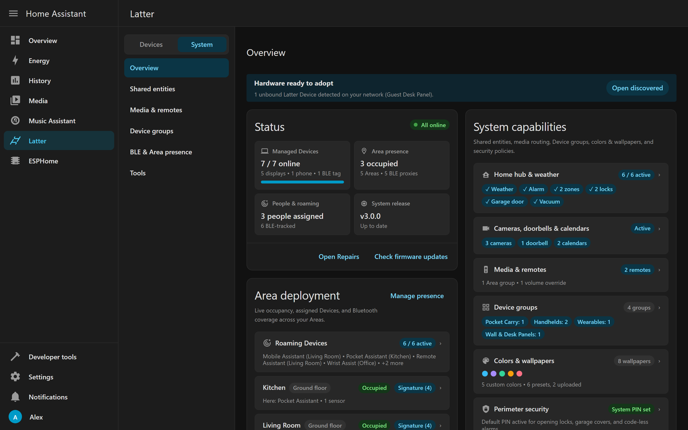
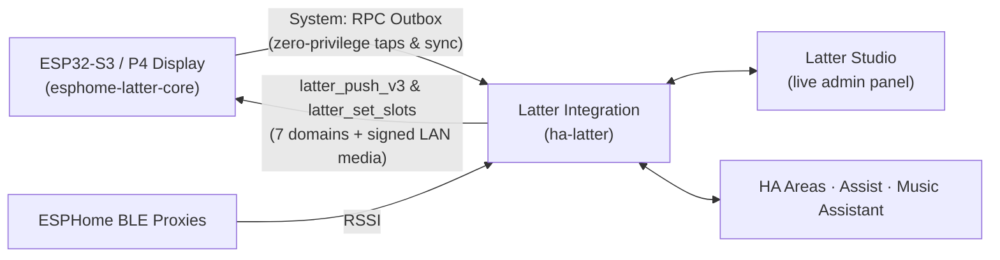

# Latter

Turnkey Home Assistant integration and **Latter Studio** control plane for ESPHome touch displays, wearables, couch remotes, and Bluetooth Area presence.

Most ESPHome display projects hardcode entity IDs into YAML—a renamed light, a new speaker, or carrying a handheld into another Area means editing YAML and reflashing. Latter keeps that mapping in Home Assistant instead: every device knows which Area it is in, and Latter pushes the right controls, media, weather, agenda, and images to it live at runtime.

| Repository | Runs on | Responsibility |
| :--- | :--- | :--- |
| **ha-latter** *(this repo)* | Home Assistant | Integration and **Latter Studio**: live entity mapping, BLE Area presence & sensor fusion, signed ESP32 media proxy, and 5 public `latter.*` services. |
| **[esphome-latter-core](https://github.com/slampton/esphome-latter-core)** | ESP32-S3 / ESP32-P4 | Compiled C++20 firmware for five Waveshare touch displays, [Web Installer](https://slampton.github.io/esphome-latter-core/), and the Latter Core SDK. |

You need both repos for the touch displays. If you only want BLE Area presence and occupancy fusion from the Bluetooth proxies, phones, watches, and beacons you already own, `ha-latter` works standalone with zero displays configured.

---

## What It Does

### Devices Know Which Area They're In
Latter reads RSSI from your existing Bluetooth proxies to track Latter displays, phones and watches (via Home Assistant's [Private BLE Device](https://www.home-assistant.io/integrations/private_ble_device/) integration), and iBeacons.
- **Voice Follows Me:** when a roaming handheld or watch moves to a new Area, Latter updates its Home Assistant Area so *"Turn off the lights"* to Assist targets where you're standing. Fixed panels sync their **Assigned Area** two-way with Home Assistant.
- **Cross-floor & sensor fusion:** per-Area occupancy binary sensors (`binary_sensor.<area>_occupancy`) fuse BLE with mmWave, PIR, and door sensors, applying a 6 dB cross-floor penalty so upstairs devices don't flap into downstairs Areas.

→ [How presence works, and how it compares to Bermuda](docs/presence.md)

### Music Assistant on a Small Screen
- **Paginated browsing:** favorites, playlists, artists, albums, podcasts, radio, and audiobooks sized to each screen's geometry.
- **Speaker moves & grouping:** transfer playback queues across speakers (holding metadata and album art steady across spin-up and healing cold/idle queues automatically) or join/unjoin speaker groups.
- **Lyrics & universal transport:** pulls synced and plain lyrics directly from Music Assistant over your LAN; transport, seek, and AV-receiver volume overrides work with any `media_player`.

### Dynamic Area Control, 5-Tab Home Hub, Live Cameras & Time
- **Area Control:** scenes, lights (brightness, HSV color wheel, 2700–6500 K temperature), blinds/curtains, fans, switches, climate, and media—ordered and filtered automatically to entities present in the active Area.
- **5-Tab Home Hub, 4-Tab Cameras & PIN Policies:** whole-home **Alarm**, **Broadcast** intercom (inline Assist STT `Speak` + paginated Quick Phrases), **Thermostat**, **Entry & Garage**, and **Vacuum**, plus a dedicated **Cameras** app (**Grid** 2×2 live MJPEG, **Single** live view + doorbell intercom, **Carousel** auto-rotation, and **Settings**). Home Assistant `alarm_control_panel` codes pass straight through for arming/disarming (`alarm_caps`), while per-device **Perimeter Security Policies** (`Auto`, `Allow`, `Require PIN`, or `Block`) guard locks, garage covers, and code-less alarms with HMAC session-key PIN unwrapping and brute-force lockout.
- **Time, Calendar, World Clocks & 2-Way Alarms:** 4-tab **Calendar** (`Overview`, `Day`, `Week`, `Month` + local event create/delete), custom-labeled World Clocks, optional UTC card, local countdown timers, stopwatch, and 3 recurring NVS alarms synced two-way between the screen and Studio.

### Auto-Detected Doorbell Popups
Latter detects your doorbell's ring entity automatically, wakes displays for 20 seconds with a live camera view, and lets you **listen** (FFmpeg noise-reduced audio) or **reply by push-to-talk** and quick replies (spoken via TTS on the doorbell's speaker; [experimental](#requirements--project-status)).

### Latter Studio
An admin-only sidebar control plane where every change pushes live without reflashing (and queues automatically for sleeping battery Devices):
- **System scope:** shared Home Hub & weather entities (searchable WAI-ARIA comboboxes), cameras (on-demand signed previews) & doorbell audio filter, dedicated **Photos** library (`/latter/system/photos`: 6 built-in presets, 15 MB multi-photo uploads with interactive crop staging, Home Assistant `/media` folder import, and collections), 24-swatch custom color library, TV/AV remotes & remote groups, operational Device groups + staged **Batch controls**, live WebSocket BLE calibration + 1-click 7-day illuminance auto-calibration, doorbell speaker testing, HMAC key rotation, JSON backup/restore, and **Support & diagnostics**.
- **Per-Device scope:** **Overview** (status tiles, quick actions, sleep-safe **Do not disturb**, **Open in Home Assistant**, assignments, and 2-way **Timers & alarms**), **Display** (**Screensaver** including *Photo frame*, **Voice assistant**, **Brightness** including per-Area *Ambient light*, **Colors**, and **Wallpapers**), **Interface** (Single-App kiosk mode, **Home screen**, drag-and-drop **App Dock**, and per-app configuration modals for **Pinned**, **Home hub**, **Cameras**, **Area control**, **Music**, **Remote**, **Sky & weather**, **Time**, **Calendar**, **Clock face**, **Tools**, and **Games**), **Audio**, **Power**, **Presence**, and **Tools** (**Developer & telemetry**).

→ [Latter Studio guide](docs/studio.md)

---

## Get Started in Minutes

**1. Pick a supported board.** All five run the full Latter OS without modification:

| Device | Waveshare Hardware | Display | Best For |
| :--- | :--- | :--- | :--- |
| **Pocket Assistant** | [Waveshare ESP32-S3-Touch-AMOLED-1.75C][ws-175c] | 1.75" round AMOLED, 466×466 | Carrying Area to Area; voice and music |
| **Mobile Assistant** | [Waveshare ESP32-S3-Touch-AMOLED-2.16][ws-216] | 2.16" square AMOLED, 480×480 | Handheld album art, sliders, and browsing |
| **Wrist Assist** | [Waveshare ESP32-S3-Touch-AMOLED-2.06][ws-206] | 2.06" watch AMOLED, 410×502 | Wearable timers, alarms, Assist, and per-person presence |
| **Remote Assistant** | [Waveshare ESP32-P4-WIFI6-Touch-LCD-3.5][ws-p4-35] | 3.5" IPS, 320×480 | Fast P4 couch remote for TVs and media |
| **Desk Assistant** | [Waveshare ESP32-P4-86-Panel-ETH-2RO / WIFI6-Touch-LCD-4B][ws-p4-desk] | 4.0" IPS, 720×720 | Always-on desk or wall panel |

Hardware links above are Waveshare affiliate links—buying through them supports Latter at no extra cost to you. (On the Desk Assistant page, both `ESP32-P4-86-Panel-ETH-2RO` and `ESP32-P4-WIFI6-Touch-LCD-4B` share the same mainboard and are validated.)

**2. Flash it in Chrome or Edge** over USB-C with the **[Latter Web Installer](https://slampton.github.io/esphome-latter-core/)**, configure Wi-Fi over the same USB cable, and adopt the discovered ESPHome device in Home Assistant (leave *"Allow the device to perform Home Assistant actions"* **off**). → [Flashing guide](https://github.com/slampton/esphome-latter-core/blob/main/docs/flashing.md)

**3. Install Latter via HACS:** open **HACS → ⋮ → Custom repositories**, add `https://github.com/slampton/ha-latter` as **Integration**, download **Latter**, and restart Home Assistant.

**4. Accept discovery & open Latter Studio:** click **Add** on **Discovered: Latter** under **Settings → Devices & Services** (or **Add Integration → Latter** with no display selected for standalone BLE presence), then click **Configure** or open **Latter** in the sidebar to map your shared entities, speakers, and colors & wallpapers live. → [Full walkthrough](docs/getting-started.md)

---

## Under the Hood

- **Zero-Privilege Bound RPC & Protocol v3 Push.** Displays bind strictly by `esphome_device_id` and hardware MAC (`via_device_id`), requiring neither `allow_service_calls` nor `device_slug` YAML substitutions. Outbound taps stream over an auto-hidden `System: RPC Outbox` entity into a private `LatterRpcDispatcher`, while inbound state pushes across 7 content-hashed domains (`area_context`, `active_media`, `remote_config`, `weather_forecast`, `calendar_agenda`, `device_prefs`, `shortcuts`) via `latter_push_v3` and `latter_set_slots`. Signed URLs and preference payloads stay off Home Assistant's `state_changed` bus and SQLite recorder.
- **Sleep-Safe Preferences & `O(1)` Area Index.** All 63 typed device preferences persist in config subentries and reconcile offline NVS edits on `device_hello`, so Studio and Device Groups work while battery handhelds hibernate. Home Assistant exposes a curated 8-platform entity surface (screen light, screensaver/DND/bedtime switches, dismiss/find buttons, group/wake-word selects, alert volume, timer/alarm states, Area occupancy, and metric BLE distance). Runtime lookups run against an incremental `O(1)` `AreaStateIndex` (`hub_registry.py`) instead of scanning `hass.states.async_all()`.
- **ESP32-Native Signed Local Media Proxy.** ESP-IDF's JPEG decoder rejects progressive JPEGs and cannot resolve `.local` mDNS hostnames. Latter re-encodes local artwork, `720p` wallpapers, camera snapshots, and live single or 2×2 MJPEG streams as baseline 4:2:0 JPEG on executor threads, applying circular masks for round screens. Every media endpoint serves over Home Assistant's numeric LAN IPv4 with constant-time, parameter-scoped HMAC signatures (`http/`).

---

## Already Running ESPHome or Building Your Own?

- **Use existing Bluetooth proxies & phones for presence:** track phones, watches, and iBeacons without flashing Latter display firmware. → [Existing ESPHome devices](docs/existing-esphome.md) · [Presence & Bermuda comparison](docs/presence.md#coming-from-bermuda)
- **Automate or build custom hardware:** everything the flagship displays use is open and documented:

| Reference | Covers |
| :--- | :--- |
| **[Services](docs/reference/services.md)** | All 5 public `latter.*` services, parameters, security PIN rules, and special targets (`all`, `occupied_areas`, `person.<id>`) |
| **[Entities](docs/reference/entities.md)** | The 3-tier entity architecture across all 8 Home Assistant platforms, occupancy attributes, and `latter_event` payloads |
| **[HTTP API](docs/reference/http-api.md)** | Signed baseline-JPEG & PCM/FLAC endpoints, Bearer wallpaper upload, and Studio WebSocket architecture |
| **[Device protocol](https://github.com/slampton/esphome-latter-core/blob/main/docs/device-protocol.md)** | Discovery, Manifest v2, 7-domain Protocol v3 push, and `System: RPC Outbox` framing |
| **[Building a GUI](https://github.com/slampton/esphome-latter-core/blob/main/docs/building-a-gui.md)** | Writing a custom touch or rotary UI on top of `esphome-latter-core` |

---

## Requirements & Project Status

| Requirement | Version | Notes |
| :--- | :--- | :--- |
| **Home Assistant** | `2026.10` or newer | |
| **ESPHome** | `2026.11.0` or newer | Only needed when compiling firmware in ESPHome Device Builder |
| **Music Assistant** | `2.10.12` or newer *(optional)* | Needed for library browsing, queue transfer, and default intercom speakers |
| **Bluetooth proxies** | 1 per Area *(optional)* | ESPHome active proxies verified; assign each proxy to its Home Assistant Area |
| **`ffmpeg`** | Optional (bundled in HA OS) | Used for noise-reduced doorbell camera audio & video streaming |

**Zero-WAN local-first network footprint:** everything in `custom_components/latter` runs 100% locally on your LAN with zero outbound WAN calls.

**Version `3.0.0` Status:**
- **Stable:** device discovery, Latter Studio, 7-domain Protocol v3 sync, Area control, Home Hub, Time/Alarms, Music Assistant browsing & transfer, BLE Area presence & sensor fusion, doorbell camera popups, and JSON backup/restore.
- **Experimental / Current Limits:** doorbell listen & push-to-talk TTS reply (no live device-to-door audio or on-device echo cancellation yet); BLE calibration uses per-scanner gain trim + multi-scanner Area signatures rather than `(x, y, z)` floorplan coordinates.
- **CI Gate:** `dev` fast-forwards `main` only after `hassfest`, HACS validation, `ruff`, `mypy --strict`, `pytest`, and the stock `esbuild` + `lit` Studio build and Playwright / axe-core E2E suites pass (see [CONTRIBUTING.md](CONTRIBUTING.md)).

Bugs and feature requests: [GitHub Issues](https://github.com/slampton/ha-latter/issues).

---

## Documentation & Removal

| Guide | Covers |
| :--- | :--- |
| **[Getting started](docs/getting-started.md)** | Unboxing to working in ~20 minutes |
| **[Latter Studio](docs/studio.md)** | Every System and Device view in the Studio sidebar panel |
| **[Presence](docs/presence.md)** | BLE Area tracking, live calibration, sensor fusion, and migrating from Bermuda |
| **[Existing ESPHome devices](docs/existing-esphome.md)** | Using your Bluetooth proxies, beacons, and phones |
| **[Automations](docs/automations.md)** | Copy-paste YAML recipes for notifications, intercom, presence, and alarms |
| **[Troubleshooting](docs/troubleshooting.md)** | Common setup, image, presence, music, and update fixes |
| **[Reference](docs/reference/)** | Services, entities, and HTTP API specs |

**Removal:** delete the **Latter** integration entry under **Settings → Devices & Services**, remove **Latter** in HACS, and restart Home Assistant. Optional cleanup on disk: `.storage/latter.site`, `.storage/latter.runtime.*`, `.storage/latter.wallpapers.v1`, and `.storage/latter/wallpapers/`.

## Support & License

Latter is free and open source ([Apache License 2.0](LICENSE)), designed, tested on physical hardware, and maintained by Sean Lampton (AI coding assistants are used for drafting code and docs; architecture, hardware bring-up, and bench validation are done by hand). Hardware bring-up costs real money—if Latter is useful to you:
- [GitHub Sponsors](https://github.com/sponsors/slampton) · [Buy Me a Coffee](https://www.buymeacoffee.com/slampton)

[ws-175c]: https://www.waveshare.com/esp32-s3-touch-amoled-1.75c.htm?&aff_id=140049
[ws-216]: https://www.waveshare.com/esp32-s3-touch-amoled-2.16.htm?&aff_id=140049
[ws-206]: https://www.waveshare.com/esp32-s3-touch-amoled-2.06.htm?&aff_id=140049
[ws-p4-35]: https://www.waveshare.com/esp32-p4-wifi6-touch-lcd-3.5.htm?&aff_id=140049
[ws-p4-desk]: https://www.waveshare.com/esp32-p4-wifi6-touch-lcd-4b.htm?&aff_id=140049
