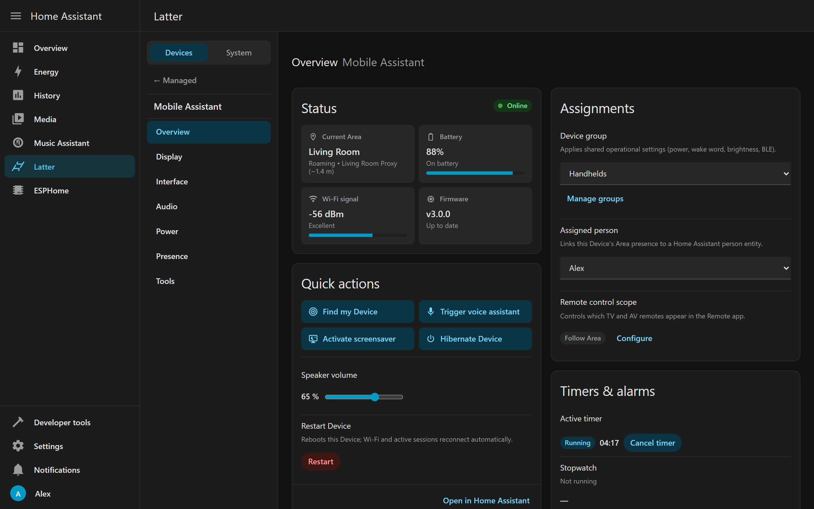

# Getting Started

This guide takes one Device from the box to fully working in about 20 minutes—or sets up a standalone BLE Area presence hub in under 5 minutes with zero displays.

## What You Need

- **A supported Device** *(optional if setting up standalone BLE presence).* See the [device table](../README.md#get-started-in-minutes).
- **Home Assistant `2026.10` or newer** with [HACS](https://hacs.xyz) installed.
- **A desktop computer running Chrome or Edge**, plus a **USB-C data cable** (power-only cables won't expose a serial port).
- **2.4 GHz Wi-Fi.** Neither the ESP32-S3 nor the ESP32-C6 co-processor on the P4 boards joins 5 GHz networks.
- **Optional:** [Music Assistant](https://music-assistant.io) for library browsing and queue transfer, and one ESPHome Bluetooth proxy per Area for roaming presence.

> **Standalone BLE presence (no display yet)?** Skip Steps 1–2, install Latter in Step 3, then go to **Settings → Devices & Services → Add Integration → Latter** and leave **Initial ESPHome Device (optional)** blank. Click **Configure** to open **Latter Studio**, where you can adopt phones/tags under **Devices → Discovered** and tune **System → BLE & Area presence**. → [Existing ESPHome devices](existing-esphome.md)

<!-- MEDIA: docs/media/getting-started-video — link to an unboxing → working walkthrough video (YouTube), not embedded. -->

---

## 1. Flash the Firmware

Open the **[Latter Web Installer](https://slampton.github.io/esphome-latter-core/)**, pick your Device, click **Connect & Install**, and select the USB serial port. Right after flashing, enter your Wi-Fi credentials in the browser dialog (Improv Serial over USB).

Prefer compiling locally? See the [Flashing guide](https://github.com/slampton/esphome-latter-core/blob/main/docs/flashing.md) for the turnkey ESPHome Device Builder YAML (`api: encryption:` + Noise-encrypted `ota:`).

## 2. Add It to Home Assistant Through ESPHome

Once on Wi-Fi, Home Assistant shows **Discovered: ESPHome**. Click **Add**, and assign the device to the Area where it lives (or usually docks).

> **Leave extra permissions off:** Latter communicates over a bound Zero-Privilege RPC channel (**System: RPC Outbox** + `esphome.<node>_latter_push_v3`). Leave *"Allow the device to perform Home Assistant actions"* **unchecked**.

## 3. Install Latter via HACS

1. Open **HACS → ⋮ → Custom repositories**.
2. Add `https://github.com/slampton/ha-latter` with category **Integration**.
3. Download **Latter**, then restart Home Assistant.

## 4. Set Up the Latter Hub & Adopt Devices

Under **Settings → Devices & Services**, click **Add** on **Discovered: Latter** (or **Add Integration → Latter**):

| Field | What to Choose |
| :--- | :--- |
| **Initial ESPHome Device (optional)** | Pre-selected when discovered—Latter binds to this `esphome_device_id` and hardware MAC (or leave blank to start a 0-display hub). |
| **Device Group** | Defaults to **Auto-detect** from the hardware manifest (*Pocket Carry*, *Handhelds*, *Wearables*, or *Wall & Desk Panels*), or pick a specific Device group. |
| **Track the Area with BLE Proxies** | Pre-checked for handhelds and wearables; automatically unchecked for stationary panels already assigned to an Area in Step 2. |

**Adding a second display, phone, or BLE tag later:** Latter uses a single System hub entry. Whenever you add more Latter displays or Bluetooth trackers, open **Latter Studio → Devices → Discovered** and click **Adopt**—Studio binds the Device in one click and jumps straight to its **Overview** page (you can also click **Ignore** on test nodes, or use **Add Device** / **Add BLE Tag** on the Latter integration page).

## 5. Configure in Latter Studio

Click **Latter** in the Home Assistant sidebar—or click **Configure** on the **Latter** integration card under **Settings → Devices & Services** (admin users only):

1. **System → Shared entities:** select your weather entity, plus any security alarm, thermostat zones, door locks, garage doors, robot vacuums, cameras, calendars, custom colors, and wallpapers.
2. **System → Media & remotes:** add TVs, streaming boxes, or AV receivers as remote slots, and map any AV-receiver speaker volumes under **Speaker volume overrides**.
3. **Devices → your Device → Overview:** set its **Device group** and **Assigned person** under **Assignments**, and configure recurring 2-way **Alarms** under **Timers & alarms**.
4. **Devices → your Device → Display & Interface:** choose your colors & wallpaper (**Home screen appearance**, **Colors**, **Wallpapers**, **Music appearance**), reorder or toggle apps on the **App Dock**, and click **Configure** on **Time** (to add custom-labeled **World clocks**), **Home hub**, or **Area control**.
5. **Devices → your Device → Audio:** pick the Device's default speaker and Assist wake word.
6. **Devices → your Device → Tools → Perimeter security** *(optional)*: set the policy (`Auto`, `Allow`, `Require PIN`, or `Block`) and PIN for locks, garage covers, and code-less alarms (Home Assistant alarm panels with their own code prompt automatically).

Every change reaches online Devices within a second or two—nothing needs to be reflashed, and edits made while a battery Device is sleeping queue automatically in Home Assistant until it wakes.

## 6. Try It Out

- **Swipe up** from the bottom edge to return Home from any app.
- Tap the **clock** on Home to open the 4-tab **Time** app, or tap **Area** to control lights, climate, and shades in the Device's current Area.
- Open **Music** to pick a speaker and browse your Music Assistant library.
- Say **"Okay Nabu"** while USB-docked (default on battery boards; change anytime in **Studio → Devices → Audio** or via `select.<slug>_wake_word_mode`).

## 7. Optional: Calibrate BLE Area Presence

With **Track the Area with BLE Proxies** enabled and one Area-assigned ESPHome Bluetooth proxy per Area, Latter provisions your System's private 128-bit BLE UUID and enables the Device's beacon automatically (`device_prefs.ble_beacon_enabled`). Open **System → BLE & Area presence** in Studio, keep **Live stream on** active, walk between Areas, and click **Calibrate Area** anywhere a neighboring proxy wins or in proxy-less interior Areas. → [Presence guide](presence.md)

---

## Quick Checks If Needed

- **"Discovered: Latter" never appears:** confirm the device is online in the ESPHome integration (Latter rescans 5 seconds after device-registry updates, or reload ESPHome to trigger a scan). If the Latter hub is already set up, look under **Studio → Devices → Discovered** (and check any collapsed **Ignored** list).
- **Screens stay empty or taps do nothing:** confirm the bound ESPHome device is online, its **System: RPC Outbox** sensor is enabled, and both `esphome-latter-core` and `ha-latter` are on `v3.0.0+` (`esphome.<node>_latter_push_v3` and `esphome.<node>_latter_set_slots` appear in **Developer Tools → Actions**). → [Troubleshooting](troubleshooting.md)
- **Replacing physical hardware:** if you swap in a new ESP32 board for an existing Device, open **Settings → Devices & Services → Latter**, click **⋮ → Reconfigure** (**Reconfigure or Replace Hardware**) on that Device subentry, and pick the replacement ESPHome device to rebind it in place while keeping all Studio shortcuts, settings, and Area rules.
