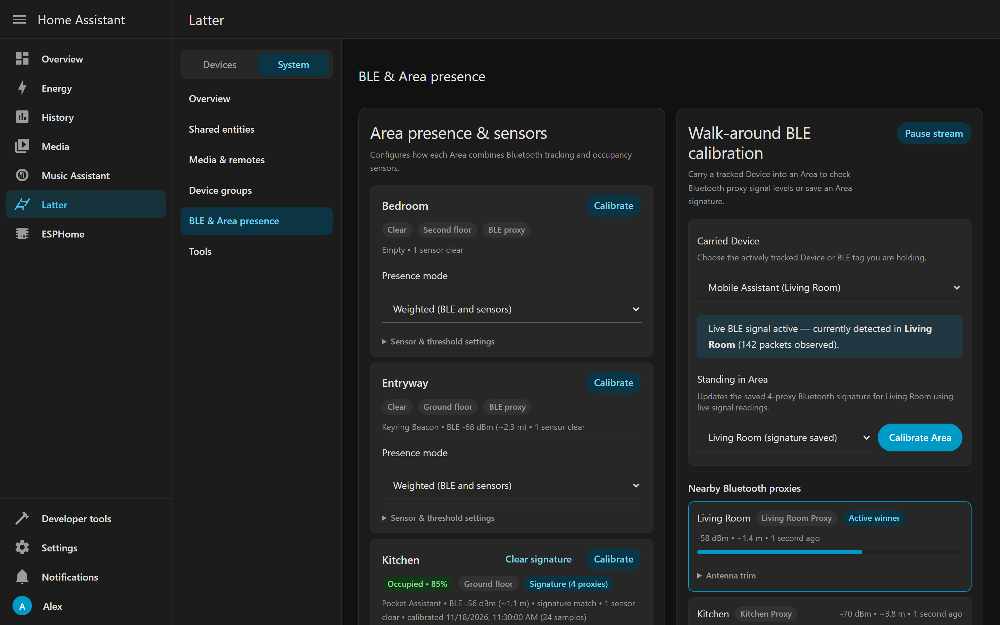

# Presence

Latter tracks which Area each Device is in using the Bluetooth proxies across your System. It then puts that Area to work: moving a roaming Device's Home Assistant Area so Assist targets where you stand, scoping Area Controls, handing off active media, and routing occupied-Area notifications and intercom broadcasts.

---

## What you need

- **Bluetooth scanners assigned to your Areas** in Home Assistant. ESPHome Bluetooth proxies (`bluetooth_proxy: active: true`) are tested; local USB adapters, Shelly proxies, and other scanners exposed by Home Assistant's `bluetooth` integration work through the same passive callback pipeline.
  - **Proxy-less Areas work too:** interior Areas without their own proxy (for example a guest bath, hallway, or pantry surrounded by 2–3 proxies in neighboring Areas) can be resolved by calibrating an Area signature in **Studio → System → BLE & Area Presence → Walk-Around BLE Calibration**.
- **Optional:** Home Assistant **Floors** assigned to your Areas. Configuring Floors enables the `6.0 dB` cross-floor vertical attenuation penalty and automatically creates `sensor.<slug>_current_floor` and `sensor.<person>_current_floor` entities.

## What can be tracked

| Target | How it's identified | How to add it |
| :--- | :--- | :--- |
| Latter firmware Devices | Bound Device MAC (`-1..+2` across Espressif's 4-MAC Wi-Fi/BLE block, excluding foreign bound MACs from fallback matching) + deterministic per-Device 128-bit UUIDv5 derived from the System's 128-bit CSPRNG BLE secret (`latter_set_beacon_uuid`, saved in NVS) + verified `major` / `minor` identity — isolating multiple identical ESP32-S3 and ESP32-P4/C6 Devices cleanly while rejecting spoofed UUIDs | Adopt from **Studio → Devices → Discovered → Latter Devices** (or enable **Track the Area with BLE Proxies** on the Device's **Presence** page) |
| Android phones (HA Companion App) | Home Assistant Companion App `sensor.<phone>_ble_transmitter` (`UUID` + `Major:Minor` + advertised `Measured power`), tracked directly with **0 ms** live attribute sync and automatic `ibeacon` duplicate suppression | Enable **BLE Transmitter** in Companion App, then **Studio → Devices → Discovered → Bluetooth Devices → Adopt** |
| iPhones, Apple Watches & other phones | Home Assistant's [Private BLE Device](https://www.home-assistant.io/integrations/private_ble_device/) integration resolves rotating IRK addresses; Latter fingerprints the live Apple/Samsung/Android device type and listens to `state_changed` on `current_address` for **0 ms RPA rotation** | Add IRK to Private BLE Device once, then **Studio → Devices → Discovered → Bluetooth Devices → Adopt** |
| Hardware BLE tags & sensors | **Apple iBeacon**, **Eddystone-UID** (`0xFEAA` frame `0x00`), **Shelly BLU / BTHome v2** (`0xFCD2`), **RuuviTag** (`0x0499`), **Tile** (`0xFEED`), **iTag** (`0xFFE0`), or static Bluetooth MAC (connectable & non-connectable) | Adopt from **Discovered → Bluetooth Devices** (**Phones and trackers** filter), or click **Add BLE Tag** |

Latter firmware ships with its BLE presence beacon inactive out of the box so a new or reset Device does not advertise until presence is configured. When **Track the Area with BLE Proxies** is enabled, Latter derives a unique per-Device 128-bit UUIDv5 from the System's 128-bit CSPRNG BLE secret (unless a custom per-Device UUID override is set), provisions it to NVS (`latter_set_beacon_uuid`), and enables advertising via Protocol v3 (`device_prefs.ble_beacon_enabled`), with battery duty tuned in **Studio → Devices → Presence → BLE Beacon Mode** (*Handheld Only*, *Handheld + Screen Off*, or *Always*). Combined with bound-MAC exclusion across the shared BLE fabric, multiple identical Devices (including ESP32-P4 boards whose BLE radio runs on a separate ESP32-C6 die) track their own Areas independently without cross-contamination. Roaming Latter Devices also pause `latter_beacon` automatically whenever Wi-Fi is disconnected (`!wifi_connected`), preventing off-site public BLE tracking and saving battery.

To link a tracked Device to a person, set **Assigned Person** during adoption or on the Device's **Overview** page. Latter creates `sensor.latter_system_<person>_current_area`, `sensor.latter_system_<person>_ble_distance` *(disabled by default)*, and (whenever Floors exist in Home Assistant) `sensor.latter_system_<person>_current_floor`, following whichever of that person's Devices was heard most recently, alongside `device_tracker.<slug>` (`home` / `not_home`) for Home Assistant `person` zone tracking (**Settings → People**).

---

## Phone & tag setup guide

In **Studio → Devices → Discovered → Bluetooth Devices**, keep the filter set to **Phones and trackers** to hide generic named laptops, TVs, and appliances while onboarding personal Devices and tags.

### Android phones with Home Assistant Companion App

Android phones running the official Home Assistant Companion App need **zero** extra integrations and **zero** manual UUID copying:

1. On the Android phone, open the **Home Assistant** app → **Settings → Companion App → Manage Sensors → Bluetooth Sensors → BLE Transmitter**.
2. Toggle **Enable Transmitter** on (recommended settings: **Transmit Power** `Medium` or `High`, **Advertise Mode** `Balanced` or `Low Latency` `1–3 Hz`).
3. Open **Studio → Devices → Discovered → Bluetooth Devices**. Your phone appears automatically by its real Device name—for example `Alex's Phone` labeled `HA Companion App (<UUID> • <Major>:<Minor>)`—complete with live RSSI and nearest Area.
4. Pick an optional **Assigned Person** in the row and click **Adopt**.

- **No `iBeacon Tracker` integration needed:** Latter binds directly to `sensor.<phone>_ble_transmitter`, seeds the phone's advertised `Measured power` (`1 m` reference RSSI, automatically compensating when Android's Companion App leaves `Measured power` at `-59` while `Transmitting power` is `ultraLow` `≈ −81 dBm`, `low` `≈ −75 dBm`, or `medium` `≈ −67 dBm`), and updates immediately via `state_changed` if you ever change the UUID, Major, Minor, or Transmit Power in the Companion App. Still, setting **Transmit Power** to `Medium` or `High` and **Advertise Mode** to `Balanced` in the Companion App is strongly recommended so neighboring Areas' proxies can hear the phone through walls. If Home Assistant's `iBeacon Tracker` integration is also installed, Latter automatically collapses its rotating-MAC duplicate rows behind your Companion App phone entry.
- **Automatic `Phone` vs. `BLE Tag` classification:** Companion App phones and `Private BLE Device` phones/watches appear under **Phones** in **Studio → Devices → Managed** (`Group: Phone`, with live `<Area> (Roaming)` display), while hardware beacons appear under **BLE Tags** (`Group: BLE Tag`). You can override any Bluetooth Device's classification under **Device → Overview → Assignments → Device Category** (*Auto*, *Phone*, or *BLE Tag*).
- **Multiple Android phones in one System:** Every Companion App install generates a unique random UUID by default. If you intentionally configure multiple phones to share a single custom UUID, give each phone a distinct **Minor** value (for example `Major: 100, Minor: 1` and `Major: 100, Minor: 2`; `0` values are also respected) so Latter isolates each person's advertisements cleanly.

### iPhones & Apple Watches (and Android without the Companion App) via Private BLE Device (IRK)

- **Why iOS cannot use background iBeacon apps:** iOS suspends third-party background `iBeacon` transmission as soon as the screen locks, so Companion App beacon emitters stop advertising in a pocket. Instead, Apple's Bluetooth LE controller continuously broadcasts encrypted Resolvable Private Addresses (**RPAs**) in hardware—even when locked or in Low Power Mode—resolvable locally with the Device's 16-byte Identity Resolving Key (**IRK**).
- **One-time IRK setup in Home Assistant:**
  1. Extract the Device's 16-byte IRK once:
     - **macOS Keychain (iPhone & Apple Watch):** On a Mac signed into the same iCloud account, open **Keychain Access**, select **iCloud** (or **Local Items**), search for `Bluetooth`, open the `MobileBluetooth` record for your iPhone or Apple Watch, and copy its 16-byte `Remote IRK`.
     - **ESP32 IRK-pairing helper (Windows/Linux, Apple Watch, or Android without Companion App):** Flash a temporary ESPHome / Arduino BLE-bonding IRK reader onto any spare ESP32, pair the phone or watch once via Bluetooth Settings to print its hex/base64 IRK over serial, then unpair the helper.
  2. In Home Assistant, go to **Settings → Devices & Services → Add Integration → Private BLE Device** and paste the IRK while the Device is nearby.
- **Adopt in Studio:** Open **Studio → Devices → Discovered → Bluetooth Devices**. Latter cross-references each `Private BLE Device` entity's live `current_address` against active Bluetooth proxy advertisements to fingerprint the hardware automatically—such as *Apple iPhone, Watch, or iPad (Private BLE)*, *Apple AirPods or Beats (Private BLE)*, *Samsung Galaxy Phone or Watch (Private BLE)*, or *Android / Pixel Phone (Private BLE)*—and tracks RPA rotations in **0 ms** via `state_changed` while immediately evicting expired MAC subscriptions.
  > *Tip:* Avoid adopting *Apple AirPods or Beats* as a person's primary Area tracker unless intended—earbuds stop advertising inside a closed charging case or stay behind on a desk while you walk to another Area.

### Hardware BLE tags — supported local tags vs. cloud anti-stalking tags

Not all keychain finders work the same way over RF. Local BLE beacons broadcast deterministic identifiers that your System's Bluetooth proxies can score every few seconds, whereas cloud crowd-sourced Find-network tags encrypt and rotate their identity specifically to block local tracking.

| Category | Hardware examples | Wire signature | Works with Latter per-Area tracking? |
| :--- | :--- | :--- | :--- |
| **Local iBeacon & Eddystone-UID beacons** | **Blue Charm** (`BC011`, `BC021`, `BC04P`), **Holyiot**, **Minew** (`E8`, `C7`), **Feasycom** | Apple iBeacon (`0x004C` `0x0215`) or Eddystone-UID (`0xFEAA` frame `0x00`) | **Yes — Best choice.** Deterministic identity, calibrated 1 m TX power, multi-year coin-cell life at `1–2 s` intervals. |
| **Shelly BLU & BTHome v2 tags** | **Shelly BLU Button1**, **BLU Tough**, **BLU Motion**, **BLU Door/Window**, custom BTHome v2 tags | `0xFCD2` service data (+ Shelly `0x0B9A` mfg ID) | **Yes.** Fingerprinted as *Shelly BLU Tag (BTHome v2)* / *BTHome v2 Tag*. Enable **Beacon Mode** in the Shelly BLE Debug app so the tag advertises continuously while idle. |
| **RuuviTag** | **RuuviTag**, **RuuviTag Pro** | `0x0499` manufacturer data | **Yes.** Fingerprinted automatically as *RuuviTag Beacon* (even without a local Bluetooth name) while reporting environmental telemetry. |
| **Tile trackers** | **Tile Mate**, **Tile Pro**, **Tile Slim**, **Tile Sticker** | `0xFEED` service UUID / data | **Yes.** Broadcasts local `0xFEED` frames (`~2 s` interval) even while paired to the Tile mobile app; fingerprinted as *Tile Tracker*. |
| **iTag keychain fobs** | Generic **iTag** (`CR2032` teardrop fobs) | `0xFFE0` service UUID + `iTAG` local name + static MAC | **Yes.** Fingerprinted as *iTag Keychain Tag*; inexpensive short-range keychain presence. |
| **Apple Find My tags** | **Apple AirTag**, Find My-only third-party cards/tags | `0x004C` separated Find My payload (`0x12`) | **No (while paired).** Rotates both BLE MAC and asymmetric elliptic-curve public key with no local IRK; separated `0x12` frames are excluded from Studio discovery. |
| **Google Find My Device / Find Hub tags** | **Moto Tag**, **Pebblebee Clip / Card / Tag** (in Google FMDN mode), **Chipolo ONE Point / CARD Point** | `0xFEAA` Google FMDN rolling EID (`0x40`) | **No (while paired to Google Find network).** Broadcasts rolling encrypted Ephemeral Identifiers (`0x40`) with no local key; excluded from Studio discovery. |
| **Samsung SmartTag** | **Galaxy SmartTag**, **Galaxy SmartTag2** | Samsung SmartThings Find rolling privacy payload | **No.** Encrypted cloud-only rolling token with no local resolution key. |

- **Why cloud Find-network tags are excluded:** Apple Find My, Google Find My Device (Find Hub), and Samsung SmartThings Find prevent unwanted stalking by rotating both the radio MAC address and an encrypted Ephemeral Identifier (**EID**) derived from asymmetric keys held only by the cloud owner account. Unlike an iPhone or Apple Watch (which shares a symmetric 16-byte IRK over standard Bluetooth bonding), cloud tags never expose a local resolution key—adopting a single rolling MAC would permanently go `Away` within 15 minutes. Latter automatically filters out rolling-EID advertisements (`0xFEAA` `0x40` and separated `0x004C` `0x12`) so **Discovered → Bluetooth Devices** never fills with dead phantom entries.
- **Want both off-Site Find recovery and local per-Area tracking?**
  - **Dual-slot beacons (recommended):** Multi-slot beacons such as **Blue Charm** can broadcast a constant local iBeacon or Eddystone-UID slot for sub-second Latter Area presence **at the same time** as a secondary slot, or you can clip a slim local iBeacon / Shelly BLU / Tile tag onto the same keyring as an AirTag or Moto Tag.
  - **Pebblebee factory-reset beacon mode:** Universal Pebblebee tags (*Clip*, *Card*, *Tag*) factory-reset out of Apple Find My / Google FMDN can advertise in unencrypted local beacon mode for Latter tracking, though doing so disables crowd-sourced cloud Find-network recovery.

---

## How the spatial engine decides

All filtering, trilateration, hysteresis, and sensor-fusion parameters live in [`custom_components/latter/presence/`](../custom_components/latter/presence/), with environmental constants tunable live in **Studio → System → BLE & Area Presence → Advanced BLE Settings**.

1. **Collect.** Latter registers passive Home Assistant Bluetooth callbacks (`BluetoothCallbackMatcher(connectable=False)` in `PASSIVE` mode, indexing into Home Assistant's connectable-wildcard bucket so both `connectable=True` and `connectable=False` `ADV_NONCONN_IND` beacons deliver live callbacks) plus per-address advertisement listeners for static-payload beacons and instant `state_changed` RPA handoff for `private_ble_device` trackers. Readings at or below `−100 dBm` are dropped, and a **3.0 dBm RSSI hysteresis deadband** suppresses minor fluctuations while the winning Area is unchanged.
2. **Filter per scanner (never blended).** Every scanner (`source` MAC) maintains its own `ScannerObservationState`—two proxies in the same Area never contaminate each other's filter:
   - **3-sample rolling median** strips single-channel BLE 37/38/39 Rayleigh multipath spikes and deep fades before smoothing.
   - **Adaptive 1D Kalman filter + velocity gate** (`Maximum Movement Speed`, default `3.5 m/s`, `0.5–15.0 m/s`) damps sudden human-body shadowing drops that imply receding faster than `max_velocity_mps × Δt`, while genuine approaches toward a scanner converge immediately.
   - After **2 s** without a packet, a scanner's score decays by **1.5 dB/s**; after **12 s**, it ages out of Area competition.
3. **Normalize & score Areas.**
   - **Reference Power Normalization:** Latter auto-detects advertised 1 m reference power from Apple iBeacon byte 22, Eddystone-UID 0 m TX power (`− 41 dB`), or `tx_power` metadata (falling back to `−59 dBm`), or uses the per-Device **Reference Power (1 Meter)** override (`−90` to `−30 dBm` on **Devices → Presence → BLE Identity**). Each scanner's filtered RSSI is shifted by its **per-scanner offset** (`±25 dB`) and normalized to a `−59 dBm @ 1 m` equivalent (`norm_dbm`).
   - **Path-loss distance & radius gate:** Distance is estimated via `d = 10^((−59 − norm_dbm) / (10 × attenuation))` meters (**Path-Loss Attenuation**, default `2.2`, `1.5–4.5`). Scanners beyond **Maximum Area Radius** (default `12.0 m`, `2.0–50.0 m`) are disqualified from claiming an Area via path-loss so outdoor leakage cannot pull a Device out of an indoor Area.
   - **Same-Area multi-scanner aggregation:** An Area with multiple scanners takes the **maximum** decayed score among its fresh scanners—never averaging a nearby scanner down with a far corner scanner—plus a **`+1.5 dB` corroboration bonus** when a second fresh scanner in that Area is also at `−82 dBm` or stronger.
   - **Multi-Scanner Area Signatures (`match_method: signature`):** Any Area with a saved vector signature—including **proxy-less Areas**—is scored by joint multi-scanner Gaussian + pairwise-differential matching across visible scanners (penalizing missing strong signature scanners) on the same dBm-equivalent scale.
   - **Cross-floor vertical attenuation:** When Floors are configured and a candidate Area sits on a different Floor from the current Area, the candidate receives **`−6.0 dB`**.
4. **Decide & prevent Area-jumping.**
   - **Wake multi-proxy coalescing (`~0.35 s`):** When a sleeping Device wakes while holding a sticky Area that has a registered scanner, an early Packet #1 arriving over TCP from a distant Area waits `0.35 s` (or for Packet #2) before switching—eliminating 20–150 ms Wi-Fi/TCP proxy race jumps while still committing genuine moves cleanly.
   - **Fast override (`≥ 8.0 dB` lead with `≥ 2` challenger packets):** Bypasses the **4.0 s** hold only once the challenger Area has delivered at least two packets, blocking single-packet multipath spikes.
   - **Standard switch (`≥ 5.0 dB` lead after `4.0 s` hold):** Switches once a challenger leads by at least `5.0 dB` and `4.0 s` have elapsed since the last Area switch.
   - No Area wins while its effective score is below **`−88 dBm`**.
5. **Away.**
   - With no matched packets for **Away Timeout** (default **180 s**, configurable `30–900 s`), BLE tags and offline Devices are marked `Away` (and `current_floor` transitions to `Away`).
   - Display Devices with a live Wi-Fi connection, intentional screen-off BLE sleep (`ble_active == false` in `device_telemetry`), or latched battery hibernation retain their last Area instead of flipping `Away`.

## Calibrating & capturing signatures

Walls, foil-backed insulation, and receiver antenna designs mean raw RSSI varies across proxy hardware and tricky boundaries.

1. **Walk-Around BLE Calibration (`Studio → System → BLE & Area Presence → Walk-Around BLE Calibration`):**
   - Choose your **Carried Device** (the picker lists strictly actively BLE-tracked Devices and BLE Tags, excluding stationary displays with BLE tracking off) and keep **Live Stream On** active (`ble_survey_delta` WebSocket stream; click **Live Stream On** to switch to **Stream Paused** whenever you want to freeze live proxy bars and packet counts for inspection). If the banner warns that no packets arrived in the last 12 seconds, wake or hold the Device so its Bluetooth beacon broadcasts.
   - Stand in the target Area for 5–10 seconds while checking **Nearby Bluetooth Proxies** (each signal bar leads with its Home Assistant Area name, proxy chip, `Active Winner` badge, and effective RSSI / distance). You can also click **Calibrate** on any Area box in **Area Presence & Sensors** to smoothly scroll to **Walk-Around BLE Calibration** and highlight the calibration target box in warning orange (`--studio-warning`) with a ready-to-calibrate banner until you click **Calibrate Area** or **Dismiss**.
   - Select the Area in **Standing In Area** and click **Calibrate Area**. Latter records the normalized multi-scanner fingerprint (`mean`, `std`, and sample count in 1 m-equivalent `norm_dbm` space) for tight boundary zones or **proxy-less Areas** surrounded by neighboring scanners, generalizing automatically across Devices with different TX powers. Click **Clear Signature** in that Area's box under **Area Presence & Sensors** at any time to return it to standard path-loss scoring.
2. **Inline Antenna Trim (`Walk-Around BLE Calibration → Nearby Bluetooth Proxies → Antenna Trim`):**
   - Expand **Antenna Trim** directly inside a Bluetooth proxy's signal row only when that proxy consistently reads louder or weaker than other proxies across every Area. Use **`-1 dB`**, **`+1 dB`**, or **`Reset`** (`±25 dB`) to normalize that receiver's gain across all tracked Devices (even while **Stream Paused** is active).
3. **Per-Device Reference Power (`Studio → Devices → <Device> → Presence → BLE Identity`):**
   - Leave **Reference Power (1 Meter)** blank to use the auto-detected advertised 1 m power shown in the placeholder, or enter a calibrated value (`−90` to `−30 dBm`) for cases, pockets, or custom tags.
4. **Advanced BLE Settings (`Studio → System → BLE & Area Presence → Advanced BLE Settings`):**
   - Expand the bottom **Advanced BLE Settings** card only if your Site needs custom System-wide **Away Timeout** (`30–900 s`), **Maximum Area Radius** (`2–50 m`), **Maximum Movement Speed** (`0.5–15 m/s`), or **Path-Loss Attenuation** (`1.5–4.5`).

---

## Area occupancy and sensor fusion

Latter creates one occupancy binary sensor and one occupants sensor per mapped Area: `binary_sensor.latter_system_<area>_occupancy` and `sensor.latter_system_<area>_occupants`. Each Area can fuse BLE presence with existing physical sensors assigned to that Area:

| Input | Effect on the Area's confidence score |
| :--- | :--- |
| A tracked Device present | `+0.85` at `−68 dBm` or stronger, `+0.70` at `−80 dBm` or stronger, otherwise `+0.54` |
| Occupancy or presence sensor on (for example mmWave) | Raises the score to at least `0.78`, plus a bonus if BLE agrees |
| Motion sensor on | Raises the score to at least `0.68`, plus a bonus if BLE agrees |
| Door or opening closed | `+0.08` |
| Occupancy sensor explicitly off, no motion, weak BLE | `−0.18` |

Presence modes, set per Area in Studio (**System → BLE & Area Presence → Area Presence & Sensors** via **Presence Mode**, with **Occupied At** threshold and **Sensors That Count** inside **Sensor & Threshold Settings**):

| Mode | Behavior |
| :--- | :--- |
| `weighted` (default) | Occupied when the weighted confidence score passes the Area's threshold (default `50%`, adjustable `20–95%`) |
| `any_or` | Occupied if BLE **or** any selected sensor is active |
| `ble_only` | BLE presence only |
| `ble_and_sensor` | Requires BLE **and** an active physical sensor (where the Area has sensors; fails closed to `off` if configured physical sensors are `unavailable` or `unknown`) |

> The weighted score is a transparent additive rule—not an opaque Bayesian network—so every transition can be inspected directly from entity attributes.

Sensors are discovered automatically by device class (`occupancy`, `presence`, `motion`, `moving`, `door`, `opening`) across both entity Areas and device Areas (excluding Latter's own `latter` domain entities so `binary_sensor.latter_system_<area>_occupancy` never feeds back into itself).

## What Latter does with the Area

- **Moves roaming Devices' Home Assistant Area (and syncs static Assigned Areas).** When a roaming Device (`stationary == 0`) with **Voice Follows Me** enabled settles into a new Area for its **Voice Follows Me Delay** (`10 s` default, `3–60 s` in **Studio → Audio**), Latter updates `area_id` on both the bound ESPHome Device and child Latter Device so area-less Assist commands target where you stand. When **Track the Area with BLE Proxies** is off, Studio's **Assigned Area** syncs two-way with Home Assistant's Device Area instead.
- **Scopes Area Controls** on the Device to its active Area.
- **Moves media with the Device**, when **Media Follows This Device to Its New Area** is on (**Studio → Audio**): switching speaker targets and transferring active playback cleanly.
- **Routes notifications and intercom.** `target_device: occupied_areas` delivers strictly to Devices in occupied Areas; if no Area is occupied, nothing plays into empty spaces. See [services](reference/services.md#special-target-values).
- **Fires `latter_event`** with `type: area_changed` for custom automations.

---

## Coming from Bermuda

[Bermuda](https://github.com/agittins/bermuda) is a mature, widely used Home Assistant BLE trilateration integration. Here is the direct technical comparison:

| Capability | Bermuda | Latter |
| :--- | :--- | :--- |
| Area sensor per tracked Device | ✓ | ✓ (`sensor.<slug>_current_area`) |
| Floor sensor per tracked Device | ✓ | ✓ (`sensor.<slug>_current_floor`, auto-created when Floors exist) |
| Area & Floor sensors per Person | Through `person` | ✓ (`sensor.latter_system_<person>_current_area`, `sensor.latter_system_<person>_current_floor`) |
| Android HA Companion App (`ble_transmitter`) | Manual UUID entry or `iBeacon` integration | ✓ **1-click auto-discovery** by phone name (`UUID` + `Major:Minor` isolation + `0 ms` live attribute sync) |
| Phones & watches via Private BLE Device | ✓ | ✓ (**0 ms** event-driven IRK RPA rotation + live Apple/Samsung/Android device-type fingerprinting) |
| Beacons, BTHome & connectable BLE | ✓ (iBeacon, Eddystone, BTHome, MACs) | ✓ (Apple iBeacon, Eddystone-UID `0xFEAA`, Shelly BLU / BTHome v2 `0xFCD2`, RuuviTag `0x0499`, Tile `0xFEED`, iTag `0xFFE0`, static MACs; rolling-EID cloud tags excluded) |
| `device_tracker` for `person` Home/Away | ✓ | ✓ (`device_tracker.<slug>`) |
| Filtering & anti-jump protection | Kalman / adaptive smoothing + velocity spike rejection | **3-sample median** (channel-hop null rejection) + **velocity-gated 1D Kalman** + **0.35 s wake multi-proxy coalescing** + **2-packet fast-override gate** |
| Calibration & RF physics tuning | Per-scanner offsets, per-device ref power, global attenuation, max radius, max velocity | ✓ Per-scanner offsets (`±25 dB`), auto/manual per-Device 1 m reference power, configurable attenuation, max radius, max velocity, and away timeout |
| Proxy-less Areas & boundary zones | Requires local scanner or manual radius tricks | ✓ **Multi-Scanner Area Signatures** resolve proxy-less Areas via multi-scanner vector matching |
| Per-scanner distance entities (`N × M`) | ✓ (`sensor.<dev>_distance_to_<scanner>`) | **No.** Exposes one closest-distance sensor per Device/Person (`ble_distance`) and streams per-scanner distances live in Studio to keep the state machine lean |
| Same entity IDs for drop-in automations | — | **No.** Automations should point to Latter's `current_area`, `current_floor`, or `occupancy` entities |

**What Latter adds natively on top of BLE positioning:** `6.0 dB` cross-floor vertical attenuation, per-Area occupancy fused with mmWave/PIR/door sensors, automatic Home Assistant Device Area sync for Assist (*Voice Follows Me*), media handoff, occupied-Area notification/intercom routing, and zero-reflash sleep-safe Studio calibration.

### Switching over

1. Ensure each Bluetooth proxy is assigned to its Home Assistant Area (and assign Floors to your Areas if your Site has multiple levels).
2. Open **Studio → Devices → Discovered**, adopt your Latter Devices, Android phones (`HA Companion App`), iPhones/watches (`Private BLE Device`), and local BLE tags, and set **Assigned Person** on personal Devices.
3. Attach `device_tracker.<slug>` to each person in **Settings → People** if you want BLE Home/Away zone tracking.
4. Walk your Site with **Studio → System → BLE & Area Presence → Walk-Around BLE Calibration** (**Live Stream On**): select your **Carried Device**, click **Calibrate Area** in any proxy-less Area or tight doorway boundary, and expand **Antenna Trim** inside any proxy row whose hardware needs gain normalization.
5. Point your automations at `sensor.latter_system_<person>_current_area`, `sensor.latter_system_<person>_current_floor`, or `binary_sensor.latter_system_<area>_occupancy`.

---

## Known trade-offs

- **Discrete Areas and Floors, not `(x, y, z)` coordinates.** Latter determines which Home Assistant Area and Floor a Device occupies (including proxy-less Areas via captured signatures), rather than estimating meter coordinates on a floorplan.
- **No `devices × scanners` entity explosion.** Per-scanner raw/filtered RSSI and distance stream live over WebSocket when calibrating in Studio instead of registering dozens of high-churn recorder entities per Device.
- **Captured signatures depend on proxy placement.** If you physically move or replace a Bluetooth proxy, recalibrate signatures via **Calibrate Area** in **Walk-Around BLE Calibration** for nearby Areas that depend on that scanner.
