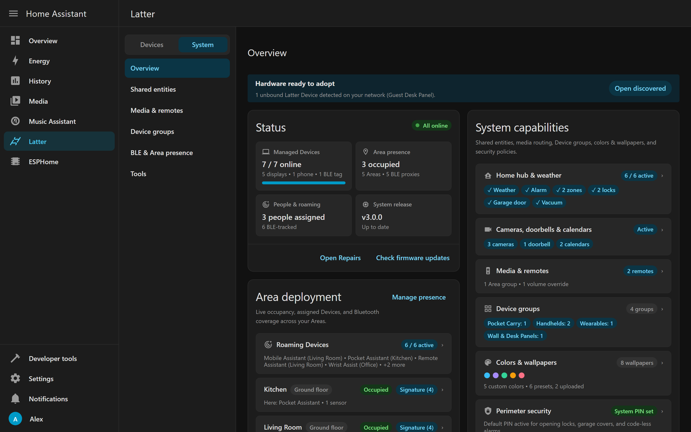
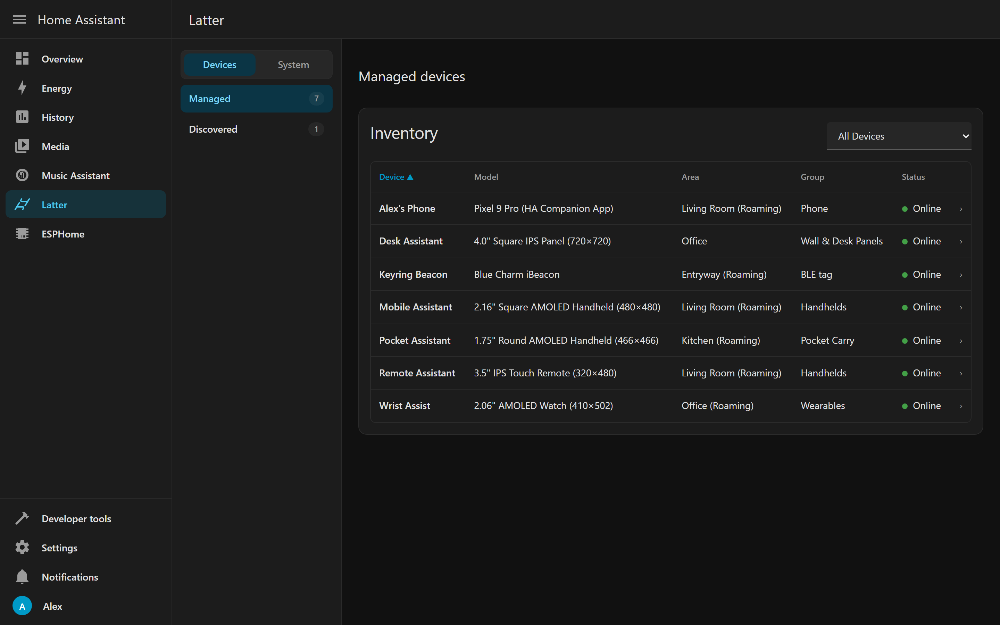
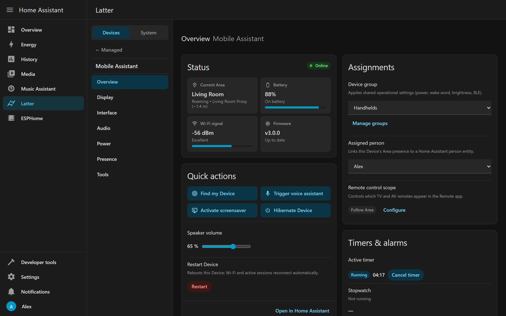
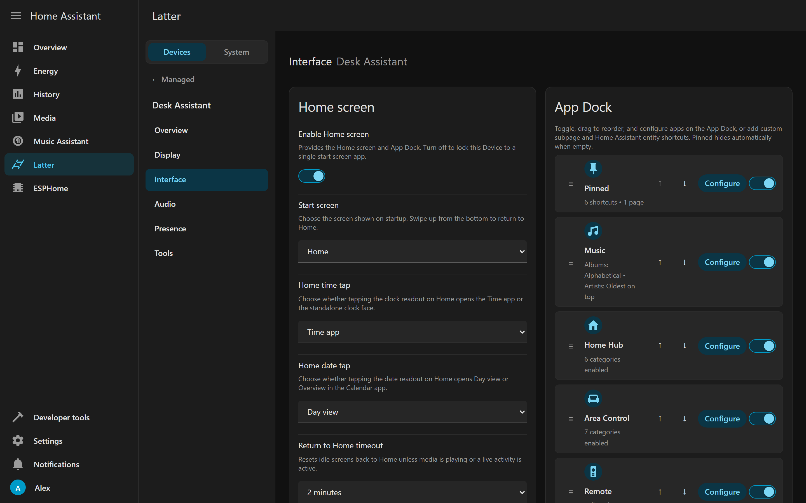

# Latter Studio

Latter Studio is the **Latter** entry in the Home Assistant sidebar—also reachable via **Configure** on the **Latter** integration card under **Settings → Devices & Services** (visible to administrators only). Use it for everything that is configuration rather than automation: every inline setting saves immediately to Home Assistant (protected by monotonic `config_rev` optimistic concurrency across tabs) and pushes live to online Devices without reflashing, while edits made to a sleeping or offline battery Device queue safely in Home Assistant and apply automatically the moment it wakes or reconnects.

Studio has two scopes in the top switcher:
- **Devices** *(default)*: per-Device dashboards and settings across all managed displays, screenless nodes, phones, and BLE tags, plus one-click onboarding for discovered hardware.
- **System**: shared Home Assistant entities, remotes, wallpapers, colors, Device groups, staged batch controls, BLE Area calibration, and System tools (works even with zero displays configured).

Controls apply immediately as they change (text and number inputs commit on Enter or blur)—**except `System → Device groups → Batch controls`**, which stages multi-Device changes behind **Apply to N Devices** and **Reset**. Searchable WAI-ARIA entity comboboxes filter large entity lists by name, Area, or `entity_id`, ordered lists and pills support both `≡` drag-and-drop and keyboard `↑`/`↓` reordering, destructive/System-wide actions open a confirmation dialog (with **Download backup first** on Restore, Remove, and Reset), URLs follow the active route (`/latter/devices/<id>/interface`, `/latter/system/presence`) for bookmarking and browser Back/Forward, and if Latter updates via the Home Assistant Marketplace while Studio is open, a **Reload page** banner appears automatically.

---

## System Views

Shared entities, remotes, colors, ignored discoveries, and overrides live in `.storage/latter.site` / hub entry storage; Device groups, BLE calibration, Area fusion, signing/PIN secrets, and Studio logs live in `.storage/latter.site`; wallpapers live in `.storage/latter/wallpapers/`.

### Overview
- **Conditional alerts:** **Needs attention** banner whenever Latter has open Home Assistant Repairs (with per-issue **Open Device** and **Open Repairs**) plus **Hardware ready to adopt** whenever non-ignored unbound Latter ESPHome hardware is detected on the network (**Open discovered**).
- **Column 1 — Status:** renders a live System health chip (`All online`, `Healthy` when non-online Devices are only `Sleeping` or `Away`, or warning chips for `Offline`, `Low battery`, `Updates`, and `Issues`), `2×2` glanceable tiles for **Managed Devices**, **Area presence**, **People & roaming**, and **System release**, plus **Open Repairs** and **Check firmware updates** footer links.
- **Column 2 — Area deployment:** promoted above the fold beside **Status**, mapping active **Roaming Devices** and deployed **Areas** with live occupancy, stationed Devices, present/sleeping roaming Devices, remotes, sensors, and BLE signature/proxy coverage.

### Shared entities
| Card | What It Controls |
| :--- | :--- |
| **Home hub & weather** | Weather provider, security alarm panel, and multi-entity **Thermostat zones** (up to 8), **Door locks** (up to 8), **Garage doors** (up to 6, filtered to garage `cover.*` entities), and **Robot vacuums** (up to 6) with searchable entity comboboxes, drag/keyboard reordering, and inline Area chips powering **Sky & weather**, **Home hub**, and **Area control**. |
| **Cameras & doorbell audio** | Up to 10 cameras (with on-demand `600 s` HMAC-signed **Preview** via `mint_camera_preview_url`, working even on 0-display hubs) for the on-device camera view and doorbell popups, **Doorbell audio filter** (*Strong*, *Light*, *Off*), and read-only **Doorbells** status showing auto-detected ring entities and active listen/reply sessions. |
| **Calendars** | Home Assistant calendars merged and deduplicated into the on-device agenda (up to 64 structured events across the lookahead window, plus local event creation & deletion on writable calendars). |
| **Custom colors** | Up to 24 shared swatch colors available to any Device whose **Color profile** is **Custom**. |

### Photos (`/latter/system/photos`)
Dedicated full-width **Photo library** managing the **6 built-in `720p` presets** (*Forest Mountains*, *Wheat Field*, *Ocean Waves*, *Sahara Dunes*, *Andromeda Galaxy*, *Mars Crater*) plus shared photo uploads and imports:
- **Upload photos & Import from Media:** multi-file drag-and-drop uploads up to 15 MB (`POST /api/latter/wallpaper/upload` with interactive pan/zoom crop staging) and a Home Assistant `/media` / NAS folder browser (**Import from Media**) with deduplication and 1-click folder-name collection creation.
- **Collections, search & crop editor:** virtual + user collections with inline Rename/Delete, live search, `36`/page pagination, **Select** bulk actions, and click-to-edit **Photo editor & crop** modal feeding both **Wallpapers** and the *Photo frame* **Screensaver**.

### Media & remotes
- **Remote controls:** up to 10 TVs, streaming boxes, and AV receivers (auto-pairing sibling `remote.*` and `media_player.*` entities, with native key maps for Android TV, Fire TV, Bravia, Apple TV, LG webOS, and Denon/Marantz).
- **Remote control groups:** named remote sets bound to Home Assistant Areas or assigned per Device from **Overview → Assignments** or **Interface → App Dock → Remote → Configure**.
- **Speaker volume overrides:** routes volume changes for any speaker to an AV receiver `media_player` or amplifier `number` / `input_number` entity.

### Device groups
- **Column 1 — Device groups:** 4 built-in hardware presets (*Pocket Carry*, *Handhelds*, *Wearables*, *Wall & Desk Panels*, each with a confirmed **Reset preset** button) plus custom groups rendered in enclosed containers, above a read-only **Custom (individual settings)** summary box showing Devices that have diverged from a group baseline (Studio shows a one-time detachment toast whenever an individual edit moves a grouped Device to *Custom*). By default each group manages **Operational** settings (power & wake timeouts, brightness schedule, wake-word mode & sensitivity, alert volume, BLE tracking, *Voice Follows Me*, media handoff, perimeter security policy) so personal wallpapers and shortcuts stay per-Device, while any group can opt into **Include display settings** and/or **Include interface & shortcuts** to enforce visual styling, shortcuts, and categories too. Includes an on-demand **Create group** header button and an inline **Baseline settings** + **Copy from Device** drawer inside each group box.
- **Column 2 — Batch controls:** stages multi-Device setting edits across *All Devices*, *Online Devices*, *Roaming Devices*, *Stationary Devices*, any configured Device group, or *Custom* across all 6 tab-aligned drawers (*Display*, *Interface*, *Audio*, *Power*, *Presence*, *Security*, all collapsed by default) plus **Copy multi-item lists** (*App Dock*, *Pinned shortcuts*, *World clocks*) without altering saved group baselines. Toggling a `Mixed` category/tool/game pill stages only that individual token change per target Device, and nothing writes until you click **Apply to N Devices** (with confirmation; **Reset** discards staged edits).

### BLE & Area presence
- **Column 1 — Area presence & sensors:** unified enclosed Area boxes showing live occupancy confidence, Floor, and BLE coverage chips (`Signature`, `BLE Proxy`, or `No BLE Proxy`), occupant and distance telemetry, per-Area **Ambient light** illuminance normalization (`dark_lux` / `bright_lux` with 1-click 7-day Recorder **Auto-calibrate**), an inline **Calibrate** shortcut that smoothly scrolls to **Walk-around BLE calibration** with a primary-blue target handoff (and confirmed **Clear signature** when calibrated), **Presence mode** (`weighted` / `any_or` / `ble_only` / `ble_and_sensor`), and an enclosed **Sensor & threshold settings** drawer (**Occupied at** `20–95%` threshold and **Sensors that count** mmWave/PIR/door pills).
- **Column 2 — Walk-around BLE calibration:** guided live calibration with **Live stream on / Stream paused** (`4 Hz` `ble_survey_delta` WebSocket stream scoped strictly to the selected **Carried Device**, with full snapshot freeze while paused), **Carried Device** (filtered strictly to actively BLE-tracked Devices and BLE tags), a live signal / 12 s sleep-wake status banner, **Standing in Area** + **Calibrate Area** inside a highlighted handoff box (capturing normalized multi-scanner Area signatures for boundary accuracy and proxy-less Areas), and Area-first **Nearby Bluetooth proxies** signal bars with an inline collapsible **Antenna trim** drawer inside each proxy row (`-1 dB` / `+1 dB` / **Reset** within `±25 dB`). → [Presence guide](presence.md)
- **Column 2 — Advanced BLE settings:** collapsed-by-default System-wide RF tuning card beneath **Walk-around BLE calibration** with **Away timeout** (`30–900 s`, default `180 s`), **Maximum Area radius** (`2–50 m`, default `12 m`), **Maximum movement speed** (`0.5–15 m/s`, default `3.5 m/s` velocity gate), and **Path-loss attenuation** (`1.5–4.5`, default `2.2`).

### Tools
| Card | What It Controls |
| :--- | :--- |
| **Notifications & announcements** | Test **Screen notification** (banner, chime, optional camera snapshot) or **Voice broadcast** (TTS announcement) to a specific Device, `occupied_areas`, or `all`. |
| **Doorbell & intercom audio** | Pick a **Source Device**, enter **Test door speaker reply**, and click **Play on door speaker** to verify TTS routing on the primary camera's speaker. |
| **Backup & restore** | **Download backup** or **Restore backup** for System or single-Device `.json` bundles (`latter.backup.v3`: subentry configuration + all 65 typed Device preferences, portable across hardware, with inline **Download backup first** before restoring). Full storage is also included in native Home Assistant backups. |
| **Perimeter security & signing** | Set a fallback **System security PIN** (used when a Device requires a PIN and has no per-Device PIN set) and **Rotate signing key** to invalidate previously issued HMAC media URLs immediately. |
| **Support & diagnostics** | Displays live version lockstep (**Home Assistant**, **Latter integration**, **Minimum firmware core**, **Studio contract**), **Copy version summary** for bug reports, **Download System diagnostics** (redacted System JSON via `auth/sign_path`), **Documentation**, and **Report an issue**. |
| **System & Device logs** | Filterable event and Home Assistant log viewer (Latter, ESPHome, Music Assistant) with **Refresh**, **Copy**, instant **Clear** for Studio events, and **Open Home Assistant logs**. |

---

## Device Views

The **Devices** sidebar splits inventory lifecycle into two top-level views:
- **Managed** (`/latter/devices`, page title **Managed devices**): sortable inventory table with humanized **Model** labels (`model_label`) whose card header updates dynamically with the selected category filter (*All Devices* by default, *Online Devices*, *Roaming Devices*, *Stationary Devices*, plus populated *Group: \<Name\>*, *Group: Custom*, *Phones*, *BLE tags*, *Assigned to a person*, *Updates available*, and System Overview deep links for *Latter displays* and *BLE-tracked Devices*; zero-member groups hide automatically). When zero Devices are managed, an onboarding empty state links directly to **View discovered Devices** and **Configure Area presence**. Capabilities come directly from each Device's Hardware Manifest v2 (screenless nodes and BLE tags hide display-only tabs).
- **Discovered** (`/latter/devices/discovered`, page title **Discovered devices**, showing a sidebar count badge whenever non-ignored unbound Latter ESPHome hardware is waiting): two stacked onboarding cards—**Latter Devices** (one-click **Adopt** that navigates straight to the newly adopted Device's **Overview** page, **Ignore** + a collapsible **Ignored (`<N>`)** drawer with **Restore**, and **Open integration**) and **Bluetooth devices** (searchable, filterable across *All Bluetooth devices* / *Phones & trackers* / *Named BLE advertisements*, sortable by *Name (A–Z)* / *Signal strength* / *Nearest Area*, and pausable via **Pause** / **Resume** during one-click **Adopt**, plus **Add BLE tag**).

### Overview
- **Conditional banners:** **Needs attention** whenever the Device has open Repairs, **Firmware update required** whenever the Device's reported `core_rev` is older than `ha-latter`'s minimum firmware core revision, plus **Device is offline or hibernating** whenever a managed display is asleep or disconnected—explaining that saved settings queue in Home Assistant and sync automatically on wake/reconnect while live **Quick actions** stay disabled until online.
- **Column 1 — Status & Quick actions:** **Status** renders an online/offline/update state chip and compact responsive `2×2` glanceable tiles for **Area** (placement & closest BLE proxy), **Battery** / **Power** (gated strictly on hardware battery capability; *Plugged in* on non-battery panels), **Wi-Fi** / **BLE** signal, and **Firmware** (gated on real `update.*` entity state; `—` when unknown); directly underneath, **Quick actions** surfaces Find My Device, Trigger Voice Assistant, Activate Screensaver, Hibernate Device, Restart Device, sleep-safe **Do not disturb**, live **Speaker volume**, and **Open in Home Assistant** + **Download backup** footer actions.
- **Column 2 — Assignments & Timers & alarms:**
  - **Assignments:** unified card for **Device group** (switches automatically to *Custom* whenever covered settings diverge from a group baseline, with **Save custom group** and **Manage groups**), **Assigned person** (plus **Device category** *Auto* / *Phone* / *BLE tag* on Bluetooth trackers), and **Remote control scope** (**Configure** opens the **Remote** modal directly on **Overview**).
  - **Timers & alarms:** conditional ringing alert banner with one-tap **Dismiss**, locally ticked **Active timer** countdown (`MM:SS` / `HH:MM:SS` from UTC `timer_ends_at`) with **Cancel timer**, locally ticked **Stopwatch** elapsed time (from UTC `stopwatch_started_at`) with **Reset stopwatch**, and a collapsed-by-default **Alarms** drawer (`All off` / `<N> enabled • <7:30 PM | 19:30>` summary chip formatted per the Device's **Time format**) containing the 3-slot recurring 1-minute alarm editor synced two-way with on-device alarm edits.

### Display *(Hardware & surface aesthetics)*
- **Column 1:** **Screensaver** (`screensaver_mode` *Docked only* | *Always* | *Never*, style including *Photo frame* with photo pool picker, rotation, shuffle, and **Show subtle clock**, plus **Preview**), **Voice assistant** (**Visual profile**), and **Brightness** (manual, Sun/schedule auto, or per-Area **Ambient light**, with `12-hour` / `24-hour` formatted schedule hours).
- **Column 2:** **Colors** (preset or **Custom color** + **Add custom color**, plus 3-way adaptive **Glass style**: *Auto*, *Clear*, or *Dark*) and **Wallpapers** (compact active pool preview, **Choose wallpaper…** / **Turn off**, rotation interval, dynamic override note when live weather backgrounds are active on **Home** or **Sky & weather**, and **Manage photo library**).

### Interface *(Home screen, App Dock & per-app settings)*
- **Column 1 — Home screen:** **Enable Home screen** (turn off for Single-App Mode locked to **Start screen**), **Start screen** (*Home*, *Pinned*, *Cameras*, *Time app*, *Calendar*, *Clock face*, or any app, paired with an inline **Configure** button when Home screen is off), **Time format** (*12-hour (AM/PM)* vs. *24-hour*, applied across Home, alarms, calendar, and schedules), **Home time tap** (*Time app* vs. *Clock face*, revealing inline **Clock face** whenever *Clock face* is selected), **Home date tap** (*Day view* vs. *Overview*), **Return to Home timeout** (exempting active media, timers, games, calls, composer drafts, and tools), **Wake greeting**, **Live weather background on Home** + **Sun & Moon** pills, and **Show Activity card** + drag/keyboard-reorderable **Activity card sources** pills.
- **Column 2 — App Dock** *(shown when **Enable Home screen** is on)*:
  - **Active on dock:** Protected Native Apps (*Pinned*, *Music*, *Home Hub*, *Cameras*, *Area Control*, *Remote*, *Sky & Weather*, *Time*, *Calendar*, *Clock Face*, *Tools*, *Games*) render non-truncating live summaries, `≡` drag-and-drop + `↑`/`↓` reorder controls, a **Configure** button (opening that app's modal), and an On/Off switch (**Pinned**, **Cameras**, and **Remote** auto-hide on-device while unconfigured; **Settings** is always locked last). Custom deep-subpage and Home Assistant entity shortcuts include **Edit** and **Remove**, above **Add custom shortcut** (lazy-loading the 7,447-icon MDI picker on demand) and confirmed **Reset default dock**.
  - **Hidden from dock:** lists any disabled native apps (*Sky & Weather*, *Time*, *Calendar*, and *Clock Face* by default) with **Configure** still active and a switch to re-enable them on the App Dock.
  - **App configuration modals (`Configure`):** **Pinned** (6-slot swipable pages + **Add pinned item**), **Home hub** (5 reorderable category pills + **Open shared entities**), **Cameras** (default view, framing, carousel interval, stream mode, doorbell popup, per-Device visible & carousel camera pills, + **Open shared entities**), **Area control** (8 reorderable category pills), **Music** (**Album art style**, **Overlay style**, + 3 library sort orders), **Remote** (**Remote control scope** + **Manage remote groups**), **Sky & weather** (**Live weather background** + **Open shared entities**), **Time** (**Time format**, **Local clock label**, **Show UTC clock**, and up to 4 drag/keyboard-reorderable custom-labeled **World clocks**), **Calendar** (**Overview lookahead** *7/14/30/60 days*, **Start week on** *Sunday/Monday*, + **Open shared entities**), **Clock face** (**Clock face** & **Time format**), **Tools** (capability-filtered *Analog chronograph*, *Bubble level*, *Flashlight*, *Calculator*, *Dice roll*, *Coin flip*), and **Games** (capability-filtered *Blocks*, *Snake*, *Drop Four*, *Marbles*, *Archery*, *Bricks*, *Chomp* — motion games shown on IMU Devices, touch arcade games shown on non-IMU Devices, and *Marbles* on all displays).

### Audio
- **Voice assistant & wake word:** **Wake word mode** (*Docked only*, *Always on*, *Disabled*), Home Assistant Assist pipeline & wake-word selects, collapsible per-model **Wake word sensitivity**, **Wake screen on Assist**, and—when **BLE Area tracking** is enabled—roaming **Voice Follows Me** + **Area follow dwell** (3–60 s; hidden automatically on Static Devices).
- **Sound & playback:** **Default speaker** (searchable combobox), conditional **Music Assistant player** override, **Media Area handoff** (active for both BLE moves and manual on-device Area picks), **Alert volume**, **Volume step size**, and **Game sound effects**.

### Power
- **Column 1 — Sleep & wake:** **Do not disturb**, **Tap to wake**, **Pickup to wake**, **Battery screen timeout**, and **Battery hibernate timeout**.
- **Column 2 — Bedtime mode & Power & battery:** **Bedtime mode** (**Bedtime mode** live switch synced with `switch.<slug>_bedtime_mode` without detaching from the Device group, **Idle display in bedtime** *Screen off* or *Ambient clock*, and optional **Bedtime schedule** with **Bedtime starts** / **Bedtime ends** hours that hold manual overrides until the next boundary) above live **Power & battery** telemetry (gated on hardware capabilities).

### Presence
- **Area tracking:** **BLE Area tracking** (`Track the Area with BLE Proxies`).
  - When **on** (BLE Roaming): **Auto-switch active Area**, **Fallback Area**, battery **BLE beacon mode** (*Handheld only*, *Handheld + screen off*, *Always*), and **BLE identity** (**BLE target address or entity**, **iBeacon UUID**, and optional `-90` to `-30 dBm` **Reference power (1 meter)** override).
  - When **off** (Static): hides roaming controls and **BLE identity**, and renders **Assigned Area**, pinning the Device to a static Area synced two-way with Home Assistant's Device Area across both the ESPHome and Latter device entries.

### Tools
- **Diagnostics:** firmware update controls (plus a **Firmware update required** warning banner/badge when `core_rev` trails the integration minimum), humanized model/node/firmware core/IP/MAC summary, **Download diagnostics** (redacted Device JSON), **Open in Home Assistant**, and a collapsed **Developer & telemetry** drawer (Telemetry profiler, Log memory report, Weather simulation, live `device_telemetry` RAM/PSRAM watermarks, BLE radio state, parsed Link report including **Session uptime**, and Hardware Manifest traits).
- **Perimeter security:** per-Device **Perimeter security policy** (*Auto (recommended)*, *Allow without PIN*, *Require PIN*, *Block unlock & disarm*) and optional **Security PIN** (falling back to the System security PIN when unset). Guards unlocking locks, opening garage/gate covers, and disarming code-less alarms; Home Assistant alarm panels with their own code validate directly against Home Assistant (`alarm_caps`).
- **Replace hardware & Danger zone:** **Replace hardware** guides you to subentry **Reconfigure** (**Reconfigure or Replace Hardware**) in Home Assistant Integrations (**Open integration**) to rebind a replacement ESPHome board in place while keeping all shortcuts, Area rules, and settings; **Danger zone** provides **Download backup**, **Reset to defaults** (via [`latter.reset_device`](reference/services.md#latterreset_device), with inline **Download backup first**), and **Remove Device** (with inline **Download backup first**).
